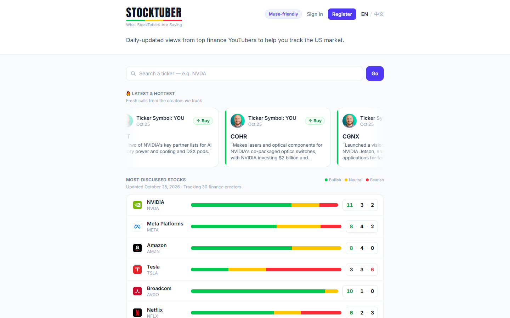

<h1 align="center">StockTuber</h1>

<p align="center"><b>What finance YouTubers are saying about US stocks — collected, organized, and summarized every day.</b></p>

<p align="center">
  <a href="https://stocktuber.com"><b>👉 Open stocktuber.com</b></a> · English / 中文 · free to browse
</p>

> This repository holds product information and community resources only.
> **It does not contain the StockTuber application source code.**

[](https://stocktuber.com)

## Why StockTuber

Dozens of finance YouTubers post new videos about US stocks every day. Nobody can watch them all, and it is hard to see at a glance whether most creators are bullish, neutral, or bearish on a stock — or why.

**StockTuber's value is aggregation and organization:** it brings many creators' views on the same stock into one place, so you can see where they agree, where they disagree, and jump straight to the source video.

## How it works

1. **Follow** — StockTuber tracks a curated set of finance YouTube creators.
2. **Read** — new videos are processed and AI extracts each creator's stance (bullish / neutral / bearish) on the stocks they discuss, with the reasoning behind it and a link to the source video.
3. **Aggregate** — the views are combined into a daily picture per stock: how many creators lean each way, and a 0–100 sentiment score.

## What you can do on the site

- **Most-discussed stocks** — today's most-discussed US stocks with bullish / neutral / bearish counts.
- **Ticker search** — look up any ticker from the box at the top of the home page.
- **Latest & hottest calls** — fresh creator views: creator, date, call (buy / hold / sell), ticker, and a short summary.
- **Stock pages** — `stocktuber.com/stocks/<TICKER>`, with the creator views behind each number.
- **Sentiment score** — 0–100 per stock, where 50 is neutral: `round((bullish% − bearish%) / 2 + 50)`.
- **English and 中文** — switch language from the site header.
- **Accounts** — register and sign in on the site.
- **Suggest a creator** — use the *Recommend a StockTuber* form on the home page.

## For developers and AI agents

StockTuber offers a free public JSON API (no API key) for the same data — for example, a daily brief for the stocks you hold:

```bash
curl -s "https://stocktuber.com/api/brief?tickers=NVDA,TSLA"
```

See **[docs/API.md](docs/API.md)** for endpoints, fields, errors, and usage notes.

## Feedback, bug reports, and ideas

- 🐞 **Bug or wrong data?** [Open an issue](../../issues/new/choose) → *Bug report* or *Data looks wrong*.
- 💡 **Feature idea?** [Open an issue](../../issues/new/choose) → *Feature request*.
- 🎥 **Want a creator tracked?** Use the *Recommend a StockTuber* form on [stocktuber.com](https://stocktuber.com).
- 🗺️ **What's changing?** See the [Roadmap](ROADMAP.md) and the [Changelog](CHANGELOG.md).
- ⭐ If StockTuber is useful to you, a star helps other people find it.

## Important disclaimer

- StockTuber summarizes what creators say. **It is not investment advice** and does not recommend buying or selling anything.
- Summaries are **generated by AI** from video transcripts and **may contain errors or miss nuance**. They are not verbatim quotes — always check the original video.
- "Most-discussed" reflects creator attention, not a recommendation. A high sentiment score means many tracked creators are bullish; it does not predict price moves.
- Creators' opinions are their own and are not facts. Do your own research and consult a licensed professional before investing.

## About this repository

A public home for product information, documentation, and community feedback. The application's source code is **not** published here and is not available under any open-source license.

---

## 中文简介

**StockTuber** 每天汇总美股财经博主（油管）的观点：哪些股票被讨论最多、博主们看多 / 中性 / 看空各有多少、理由是什么，并可以直接跳到原视频。

👉 网站：**[stocktuber.com](https://stocktuber.com)**（支持中文）

- **核心价值**：把很多博主对同一只股票的看法聚合、整理到一起，一眼看出共识和分歧。
- **功能**：最热门股票、最新博主观点、个股页、0–100 情绪分、中英文切换、账号注册登录、推荐博主表单、免费公开 API（见 [docs/API.md](docs/API.md)）。
- 本仓库只包含产品介绍和社区反馈入口，**不包含应用源代码**。
- 摘要由 AI 生成，可能有错误，并非博主逐字原话；**不构成投资建议**。
- 发现问题或有想法，请在 [Issues](../../issues/new/choose) 里提交；想推荐博主，请使用网站首页的「推荐博主」表单。
